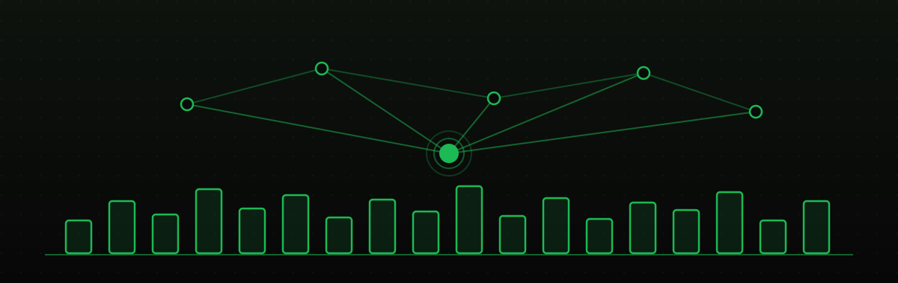

저는 AI를 활용해 서비스를 개발하고 인프라를 운영하는 DevOps 엔지니어 박가람입니다. 최근에는 AI가 여러 서비스의 코드를 함께 참조할 수 있도록 저장소를 모노레포로 옮긴 경험과, 코드를 작성하기 전에 명세를 바꿔 본 경험을 글로 남겼습니다.

## 이 블로그에서 다루는 것

요즘은 Kubernetes, DevOps, AI 운영을 실제 서비스에 적용하면서 겪은 이야기를 주로 씁니다. 무엇이 잘 됐는지보다 어디서 깨졌고 비용이 얼마나 들었는지를 솔직하게 남기려고 합니다.

그 전부터 정리해 둔 기록도 함께 있습니다. 디자인 패턴, 자료구조·알고리즘, Docker, MariaDB, 정규표현식처럼 오래 쓰이는 기본기들은 상단 카테고리에서 찾아볼 수 있습니다.

## 연락처

- LinkedIn: [linkedin.com/in/garam-park](https://www.linkedin.com/in/garam-park-7ab39793/)
- GitHub: [github.com/garam-park](https://github.com/garam-park)
- YouTube: [@story.g](https://www.youtube.com/@story.g)
- Email: [garam-park@naver.com](mailto:garam-park@naver.com)
